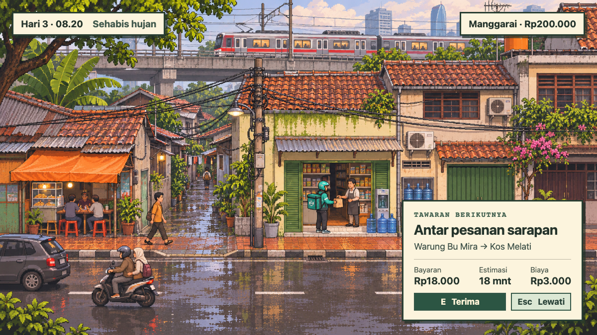

# Sehari di Jabodetabek

A single-player 2D pixel-art life sim set in Greater Jakarta. You start a week after graduating from SMA, find your first job, and build a life one shift at a time.

The first playable prototype follows one week in a Manggarai-inspired block, with ojek delivery and toko galon & sembako as the two starting careers. Everyday work uses reusable job templates. A small cast of recurring neighbors gets authored stories.

## Project files

| File | What it covers |
| --- | --- |
| [Game design document](docs/game-design.md) | Opening story, careers, economy, progression, shared campaigns, art direction, and production scope |
| [GDD PDF](docs/Sehari%20di%20Jabodetabek%20Game%20Design%20Document.pdf) · [Word version](docs/Sehari%20di%20Jabodetabek%20Game%20Design%20Document.docx) | Illustrated GDD v0.2 |
| [Prototype plan](docs/prototype-plan.md) | Build order, character movement, and playtest criteria |
| [Art reference](art/README.md) | Pixel-art scene concepts and interface mockups |

