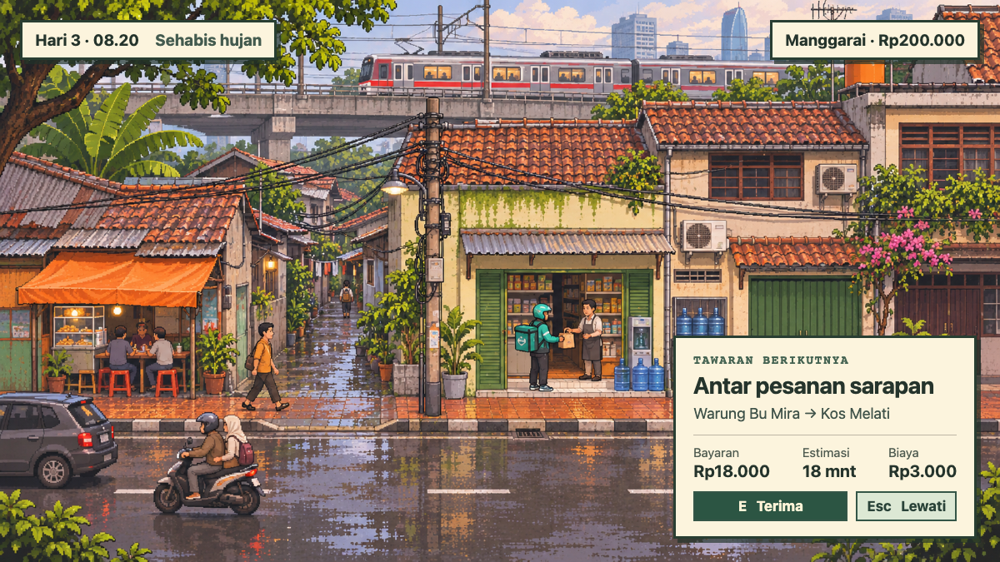
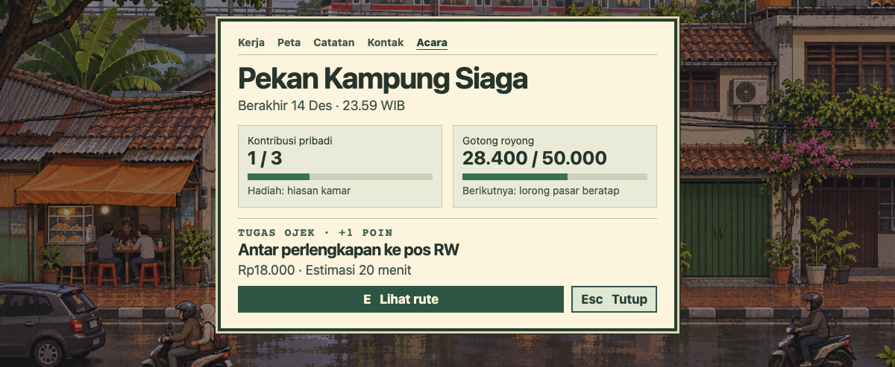
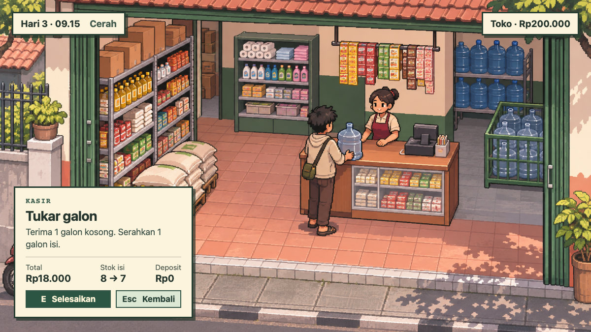

# Sehari di Jabodetabek

Game Design Document

Working title  •  Concept v0.2  •  24 November 2026

You are 18 and a week out of SMA, Indonesian senior high school. You start with a modest kos room, a little savings, and an introduction to your first job in Greater Jakarta. Spend the morning taking ojek orders, minding a neighborhood toko, or working another local trade. Take an extra job when you need the money. Knock off early when you have plans. Over time, regulars know your name, your tools improve, and more of the week becomes yours to plan.

**Format** Single-player 2D pixel-art life sim with optional online community campaigns. PC first, with Bahasa Indonesia and English planned. One main role per save at launch.

**Player goal** Make a life you want to keep living. Stability, mastery, relationships, and time off all count as progress.

*Ojek shift mockup. The job offer makes the pay, time, and cost visible before the player commits.*

**Design pillars** Give each job a decision worth making. Let the same neighbors return in different contexts. Make upgrades save time or expand choices. Give every shift a natural stopping point.

## The First Week After Graduation

### Opening scene

A week after graduation, you wake up in a small kos near Manggarai. The first rent payment is due Sunday. In the class group chat, one friend is preparing for university and another has started work. A neighbor messages you with an introduction to someone who needs an extra pair of hands.

You have no work references or regular customers, and the tools you can use depend on who will lend them to you. The game expresses those limits through the first offers you can take. A mentor introduces you to a small task with clear terms, and a successful handoff or checkout gives someone a reason to ask you back.

### The first playable shift

**Choose a role and meet a mentor.** Pick your name and appearance, then choose a starting career. The prototype offers two paths that open on the same block and use the same rent calendar.

**Ojek opening.** Borrow a scooter through your mentor and take a short breakfast delivery on the fictional delivery service. Review the pay and pickup, ride to the warung, and settle the handoff at a nearby kos. Later milestones open passenger rides and a wider area.

**Toko opening.** Cover the counter with a shopkeeper nearby. Make your first galon exchange, check the remaining stock, and see the sale in the ledger. One of the first customers lives close enough to become a regular.

**End the first day with a choice.** Take another paid errand, help a neighbor, or go home early. The daily review shows the pay received and the amount due Sunday. Putting money into the rent envelope is optional.

### The first sign of progress

Your first paid task should land within ten real minutes. Within the first week, aim to earn a repeat invitation, such as a rider’s standing pickup or a shop customer’s refill reservation. That invitation makes progress visible in the next shift. The first rent bill can be met through several combinations of main work, errands, and starting savings.

**Later career openings** A creator can film a paid stall clip on their own phone. A trainee at a local TV station starts with footage logging and errands before a supervised field assignment. The career’s first public-facing milestone is a repeat client or a credited contribution to a segment.

## Daily Life and the City

### The daily loop

**Plan.** At home, check weather, rent, and two or three offers on your phone. Pick the morning’s priority, pack what it needs, and decide when to quit. The forecast shows the effect of rain on travel or foot traffic.

**Work.** Spend a shift on your main role. A rider weighs a station pickup against an order heading home. A shopkeeper decides how many galon to reorder before closing. Each staple job has one hands-on trade decision and a short resolution.

**Spend the rest of the day.** Take a small paid errand, eat at a warung, see a neighbor, improve the room, or go home. Some favors pay in introductions or goodwill, listed up front.

**Close.** Review take-home cash, upcoming bills, and progress. Sleep advances the calendar. Prototype pacing is 12–16 real minutes for a full day at default speed, with early close, pausing in menus, and optional slower time. Skipped days advance bills only through an explicit calendar action that previews the charges.

### A compact Jabodetabek

Use dense, walkable neighborhood maps with short transit links. A district is a composite of familiar places, with real city names for orientation and fictional shops, characters, and employers. Playable spaces combine homes, work sites, and regular stops a player can learn by sight.

| Location | Playable identity | Release target |
| --- | --- | --- |
| Jakarta | Manggarai-inspired station and adjacent kampung, with kos rooms, warung food stalls, and a supply market | Prototype and launch |
| Depok | Station feeder streets, student kos clusters, and an alterations stall | Launch |
| Bekasi | Residential blocks, repair kiosks, and a bank sampah collection point | Launch |
| Tangerang | Market and supplier district with a bulk restock route | Expansion |
| Bogor | Rainy station neighborhood with sheltered errands and weekend visitors | Expansion |

Walk for alley shortcuts, ride for local jobs, or take a simplified commuter connection between districts. Station gates, pickup bays, shop hours, and one or two scheduled bottlenecks carry the geography. Job cards show predicted travel time. NPC schedules make the same street feel different across the day.

**Life outside work** A short visit, a shared meal, or helping with a neighborhood request can reveal a new contact or a future booking. The player can also spend that time resting or exploring a route before taking a job there.

## Ojek Online and Toko Galon

### Ojek online driver

**Work loop** Go online and compare offers by pay, pickup, deadline, destination, and running costs. Choose a route, collect a passenger or order, and confirm the handoff. Ride on the left, use signals, and steer at low speed. Rain changes timing and visibility. A late handoff can reduce the bonus. Move blocked pickups to a marked meeting point.

**Progression** Start with a borrowed scooter and local food deliveries. After four clean handoffs and a mentor check, unlock station passengers and a second pickup zone. Complete a scheduled-delivery chain and upgrade the cargo rack to carry compatible paired parcels. Build toward owning the scooter and choosing among repeat clients and open orders.

**Side mission — Last Train Home.** First learn where the station shutters close, then help Bu Mira agree on a covered pickup point for her late shifts. Completing the two-part favor adds a recurring ride with a known pickup and flexible window.

**Side job — Morning Bread Run.** Pick up a bakery crate before the commuter peak. Compare the guaranteed pay against an early station shift. Learn the bakery’s alley as a permanent shortcut.

### Toko galon and sembako keeper

Run a family shop with optional Cici or Koko nicknames in dialogue, alongside customizable names and pronouns. Sembako are household staples. Galon are large water jugs that customers can exchange.

**Work loop** Open the counter, stock a compact selection of essentials, fill baskets, and handle jug exchanges. Returning an empty pays only the water price. A jug taken without an empty incurs a refundable container deposit. Keep a small ledger and finish the day with a restock decision. The water arrives sealed from the supplier.

**Progression** Begin on a shared counter with six goods and one rack. Complete a supplier order and three days of accurate stock counts to unlock wholesale bundles and reserved pickups. Buy a second rack and complete a standing-order trial to add recurring kos deliveries. A late upgrade lets family cover a shift at a clear cost.

**Side mission — Galon for the Kos.** Ask three tenants for their refill days, then set a collection window with the caretaker. Choose one larger delivery or two lighter trips. Success unlocks a weekly standing order.

**Side job — Saturday Hampers.** Assemble preordered rice, oil, and sugar bundles for the RT. Decide whether to reserve inventory now or make a wholesale trip before the pickup window.

### A job can go sideways

Explain what happened and show the next action. Substitute an unavailable item with the customer’s consent or remove it from the bill. Canceled deliveries pay the travel allowance shown on the offer.

## Three More Careers

### Tukang permak pakaian

A neighborhood tailor earns per alteration and occasionally takes small batches. Intake shows a garment silhouette, requested changes, deadline, and quoted supplies. Mark the adjustment, choose a stitch or closure, then test the fit. Practice mode and assisted stitching are available. Speed affects throughput. Accuracy affects rework and referrals.

**Progression** Work from a borrowed machine on hems and simple seams. Finish three accepted repairs and a fitting check to unlock zippers and school uniforms. Buy a reliable machine and complete a uniform batch to open a pasar stall with scheduled fittings. At mastery, specialize in quick repairs or recurring batch work.

**Side missions** In *Uniform Before Monday*, find matching thread and fit a student before school. The family becomes a regular. In *Old Kebaya*, talk through what the owner wants preserved, then make a reversible adjustment that earns a story and a keepsake pattern.

### Tukang servis elektronik kecil

A small-appliance repairer earns for bench jobs and home visits. Inspect an item, match symptoms to a simple diagnostic puzzle, select a compatible part, and run an in-game test. Quote up front and get consent if a hidden fault changes the price. Rejecting an uneconomical repair takes less time and retains some goodwill.

**Progression** Take low-complexity fan and lamp jobs on a shared bench. Complete three verified repairs and a mentor diagnosis to unlock a parts supplier and scheduled home calls. Upgrade the bench and complete a batch refurbishment to secure service agreements with kos managers.

**Side missions** In *Fan for the Pos Ronda*, choose to refurbish a donated fan or find a used replacement before the evening shift. In *Two Receipts*, trace a swapped item across two customers and schedule a collection that keeps both appointments intact.

### Pengelola bank sampah

Operate a neighborhood waste bank. Group safe, clean recyclables by material, weigh them, post household receipts, and decide when a buyer pickup is worth the transport. The player receives a cooperative shift stipend and a transparent share of handling surplus. Household proceeds stay in a community ledger.

**Progression** Start as a paid assistant on sorting days. Run three supervised intakes with correct receipts to manage your first collection point. Set up covered storage and meet a buyer’s quality target to unlock pickup routes. At mastery, coordinate two partner sites with different material demand.

**Side missions** In *Cardboard Before Rain*, arrange shelter and move a school’s batch before the storm. In *Empty Bottle Saturday*, choose accessible drop-off hours with shopkeepers, then trace contamination to improve sorting signs and unlock a regular contribution route.

**Repeatable side jobs** Hem a single pair of trousers, collect and return a repaired lamp, or help staff the waste bank on collection day. Show the pay and expected time on the noticeboard. Basic versions are available through mentor NPCs to any career.

**Career scope** Bank sampah is a post-launch career candidate. Its campaign tasks can run through an NPC-led collection point at launch.

## Creator and Local TV Careers

### Short form video creator

**Work loop** On a fictional TikTok-style app, choose a topic and decide where to film. Ask permission where needed, record short clips, then assemble a post by choosing a hook, two or three shots, and an ending. A timely post can catch a neighborhood event. A recurring series can build a dependable audience.

**Progression** Start with a basic phone and do paid clips for local stalls. Publish three episodes in one niche to unlock a recurring series slot and pitch small commissions. Complete two client briefs to unlock better audio equipment and larger bookings. At mastery, deliver a commissioned city series with a repeat client.

**Money and feedback** A paid brief shows its fee, deadline, and expenses in advance. Posts show which audience they reached and whether they helped open new briefs. Followers lead to opportunities. Rent depends on actual paid work, such as commissions and side gigs, with a baseline slot available through the mentor.

**Side missions** In *One Stall One Morning*, a food vendor pays for a short clip before the lunch rush and supplies a recurring brief if it meets the agreed requirements. In *Under the Awning*, scout a sheltered pickup spot and make a commuter guide that becomes the first episode of a station series.

### Local television field reporter

**Work loop** Take an assignment from a fictional local station. Travel to the location, interview people, collect footage, and verify facts before filing a short segment. Under deadline, choose whether to file a narrower verified story or ask the editor for time to confirm another detail.

**Progression** Start as a paid desk assistant logging footage and running errands. Complete two supervised assignments to earn a field credit and take neighborhood reports. File a three-story beat package to pitch your own segments. At mastery, coordinate a small shoot and produce a longer story across multiple locations.

**Money and feedback** Desk shifts pay a fixed amount. Field briefs show a fee and travel allowance. Credits and editorial trust unlock beats and production resources. A correction takes time and may affect the next assignment. The desk shift remains available as a fallback.

**Side missions** In *Where Did the Pickup Move*, interview riders and passengers at a Depok station and confirm the change with station staff before the evening slot. In *The Shop With Two Receipts*, follow a wrong headline back to its source and file a clear correction.

**Production test** Trial a paid market-stall video and a supervised neighborhood news segment as optional jobs on the existing map. Both reuse filming points, NPC availability, travel, and deadlines. Editing for an audience and verifying evidence are the two distinct mechanics to prove before building full career ladders.

## Economy and Balance

Wallet cash covers rent, meals, transport, maintenance, and supplies. Savings is an optional envelope in the same ledger. A weekly review shows bookings, direct costs, household expenses, and affordable upgrades. Price tags and jobs use whole rupiah with Indonesian separators. Figures below are tuning values for compressed game time.

| Starter economy | Prototype value | Purpose |
| --- | --- | --- |
| Opening cash | Rp200.000 plus role starter kit | Toko starts with its first inventory, others with tools or materials |
| Weekly kos rent | Rp105.000 | Due at the close of Day 7, then weekly |
| Meal and recovery | Rp10.000 per workday | Optional food purchase restores energy. Rest also restores it. |
| Routine reimbursements | Actual stated job allowance | Compensation on applicable canceled offers |
| First equipment upgrade | Rp180.000–240.000 | Saves work time or improves capacity |
| Starter shift surplus | Rp30.000–45.000 | Typical operating surplus for a 3–4 game-hour shift before household expenses |

**Ojek example.** Three completed orders bring in Rp54.000. Set aside Rp10.000 for fuel and Rp4.000 for wear and scooter use. Estimated shift surplus is Rp40.000. Wallet cash moves when orders settle and fuel or upkeep is paid, so the daily ledger shows actual and accrued costs separately.

**Toko example.** Eight sales bring in Rp120.000, with Rp80.000 in replacement inventory and Rp5.000 in supplies. Operating surplus is Rp35.000. If a customer leaves a Rp25.000 jug deposit, record that separately as cash held for a refund and exclude it from spendable cash. Store inventory is paid at restock and counted as cost when sold.

**A playable week.** Five shifts at Rp40.000 average surplus generate Rp200.000. After Rp105.000 rent and five Rp10.000 meals, Rp45.000 remains. Two optional Rp15.000 errands raise that to Rp75.000. Starting cash gives early room to choose between buying an upgrade, saving for rent, and taking a day off.

**Supply and demand.** Local forecasts rotate one meaningful variable per shift. Wet afternoons favor short covered drop-offs, payday raises staple demand, and market day improves supplier choice. Starter price bands stay bounded. Stock caps and recurring demand encourage planning a few items ahead. Shops reserve inventory when a booking is accepted.

**Recovery.** Missed rent triggers a grace week and a visible repayment split across the following two rent weeks, with one outstanding arrangement at a time. Guaranteed jobs provide money without upfront spending. Loaner equipment, close-by work, and resting at home keep every role playable from zero cash. Avoid forced resets and compounding fees.

## Life Progress and Relationships

### Progress over a season

A career moves through beginner, independent worker, dependable regular, and established specialist milestones. A repeat customer or a credited segment is an early sign that someone trusts the player with more responsibility. Milestones combine a concrete mastery task with a practical improvement. Each unlock should improve a choice the player already understands, such as taking a second parcel or promising a regular pickup window.

| Life milestone | Example requirement | What changes |
| --- | --- | --- |
| Find your footing | Pay first rent and complete a mentor task | Learn a recovery job and pin a personal goal |
| Build regulars | Finish two neighbor stories and unlock one recurring booking | Plan a predictable shift and keep an afternoon free |
| Make room for yourself | Finish one career capstone and any two personal goals | See a neighborhood chapter finale and keep playing |

**Personal goals** Pick from saving two weeks of rent, furnishing a room, mentoring an apprentice, helping with a neighborhood project, or keeping a dependable four-shift week. Each goal tracks an explicit condition. Free time and community favors open scenes and reciprocal help. Relationships stay stable across missed visits.

**Home and energy** Upgrade a kos room with functional furniture and small decorations. A better bed improves morning energy. A wall shelf gives a place for keepsakes. A home meal and a short rest offer different combinations of money and time cost. Use one energy meter throughout the game. When it is low, shorten a shift or take a break. Rent and meals are the common household budget.

**Requests and schedules** The phone shows up to three pinned tasks, the next payment due, and a lead for each active neighbor story. Handwritten favors begin in dialogue or on an RT noticeboard. Recurring side jobs show pay and time in advance. A missed story window rolls to the next occurrence. Seasonal stories return through the calendar or archive.

### Changing roles in a later update

After a capstone, visit the new trade’s mentor and choose an effective date at the end of the week. Start the new career at its first rank with the same training gates and starter tools as a new character. Keep your room, savings, calendar, and friendships. Shelve the old business assets and pause its bookings. Outstanding orders must be fulfilled or canceled with the displayed settlement before the switch. Rank and role licenses belong to each trade. Rejoining a previous trade restores its archived rank after a refresher shift.

**New-career balance** Experienced characters may pay ordinary expenses from savings. Role-specific gear tiers, clients, and contracts still require that trade’s milestones. Basic side errands remain accessible across careers.

## Shared World Campaigns

Every player sees the same campaign calendar and aggregate progress while playing a private copy of the city. The event service publishes dates, job templates, counter targets, and a final outcome. Local saves own characters, cash, relationships, jobs, and time of day. The shared result changes approved public map details, such as a reopened covered market lane.

### Pilot campaign Pekan Kampung Siaga

In a 14-day real-world event, residents prepare a neighborhood route for the rainy season. A player contributes by completing a role task during ordinary play. The phone shows the deadline in WIB, personal progress, the global meter, and the next visible change. The starter event job fits inside a normal shift. Sample contributions include delivering a preparation kit by ojek, boxing staples at the toko, mending rain covers, repairing a donated fan in the game, or weighing clean recyclable material at a collection point.

*Campaign phone mockup. Personal and community milestones sit side by side with a task suited to the player’s role.*

**Pilot rules** Each completed eligible job adds one point, capped at three per account per WIB day. Three personal points earn a room decoration. The target begins at 50.000 points and is tuned to expected participation before the event opens. At 50% an NPC work crew appears. At 100% the covered lane opens in participating city maps when players sync. If the counter falls short, the lane remains partially set up and the complete layout returns in a later campaign rerun.

**Sync and continuity** The service uses versioned event manifests, server timestamps, and a unique contribution ID per event task completion. Retried uploads deduplicate before the tally updates. Locally verified task completions can queue while offline and submit within a 48-hour grace period, subject to plausibility checks and the daily cap. Finalize shared results after the grace period. Reward claims are idempotent. The base game saves and runs offline. Past jobs return in an archive with an equivalent cosmetic on a separate local track. Online contributions are opt-in and aggregate totals are public.

## Visual Direction and Interface

### Pixel art and sound

Use a three-quarter top-down camera with 16-pixel tiles and a 480 × 270 gameplay canvas that scales by whole numbers where possible. Keep character and vehicle silhouettes distinct from wet pavement and busy storefronts. Use sharp pixel clusters with a warm concrete palette, blue galon, and rain-muted shadows. The illustrated mockups use a closer camera for visual direction. Display UI at output resolution so Indonesian text stays readable.

*Toko counter mockup showing the empty jug exchange, stock change, amount due, and deposit.*

**Environmental details** Build districts from tiled thresholds, rolling shutters, potted plants, kos noticeboards, canopy cloth, and utility lines. Let shutters, crowds, puddles, and lighting show the time and weather. Keep traffic cues visible in heavy rain. Ask local workers and Bahasa Indonesia reviewers to validate dialogue, terminology, prices as game abstractions, and job rituals before final content production.

**Audio** Use distinct cues for phone offers, stock confirmation, and the end of a shift, with captions or visual signals for important sounds. Build location ambience from train brakes, awning rain, scooter idle, and distant storefront chatter. Use original recordings or cleared assets.

**Interface and access** Keep time, weather, wallet, and current action visible during a shift. The phone contains Jobs, Map, Ledger, Contacts, and Events. Offer keyboard and controller remapping, UI scaling, reduced flashing and camera shake, hold toggles, assisted trade tasks, and routes distinguished by icons as well as color.

**Save behavior** Provide three local slots, save at job settlements and day-end, and offer Save and Quit in safe locations. A settlement records items, cash, and objective state together so a reload restores a consistent point.

## Reusable Jobs and Neighborhood Stories

A busy street needs people moving through it, customers who can place orders, and a few neighbors with reasons to remember the player. Each needs a different amount of writing. Keep ordinary work in structured templates and give bespoke scenes to relationships that change through play.

### How new interactions are made

**Ambient pedestrians** Use a small set of origins, destinations, and time windows. A commuter can head to the station in the morning and take shelter when it rains. Brief contextual lines cover an incidental greeting or direction request.

**Customers and sources** Give each repeat customer a schedule, a relevant preference, and eligible job types. Media sources can also have interview windows and facts they can confirm. The same character can serve several roles when it makes sense. Add a relationship state only where it changes an offer or scene.

**Authored neighbors** Give mentors and recurring characters a short arc with a clear change at the end. Bu Mira’s *Last Train Home* story unlocks a standing pickup with a shelter preference. Later bookings use the normal pickup template, which selects an available location from that preference and the weather.

### What a job template needs

Define required location and NPC roles, delivery or interaction steps, time window, cost and payout, and one or two allowed complications. Each variant needs a gameplay consequence. A galon checkout uses the same steps for any customer, but a returned empty changes the deposit and stock. Reserve scarce stock or time windows when a job is accepted. If a prerequisite is unavailable, substitute an eligible location or offer a known valid job.

Reuse the calendar, travel, dialogue triggers, ledger, and settlement across careers. Keep role-specific mechanics distinct. The creator selects and orders footage. The reporter evaluates sources and decides what can be filed. A new district can provide locations, schedules, and sources usable by both.

### How to check that it scales

In the first playable week, use four named NPCs, two authored stories, and a few rule-driven variants per career. Add a fifth neighbor with a schedule and an existing job preference, then add a campaign job by tagging a supported template. Both should work through content data and ordinary settlement. Use fixed-seed weeks to test for impossible bookings, duplicate rewards, and excessive repetition.

Ask players which neighbor they remember and what they did differently on a later shift. If their answers concern only new names or different scenery, improve the underlying choices before expanding to more districts or careers.

## Production Scope and Tests

| Stage | Playable scope | Gate |
| --- | --- | --- |
| Prototype | One Manggarai-inspired block, one complete week, ojek and toko roles, shared ledger, four NPCs, two side stories | First-shift story, rent pacing, and ordinary jobs work in both roles |
| Vertical slice | Polished prototype, weather, one commute connection, controller, one event rehearsal, Bahasa Indonesia and English text pipeline | A new neighbor and event job work through existing templates. Save and event sync pass a full playthrough. |
| Launch target | Jakarta, Depok, Bekasi, four careers, 12 named NPCs, at least two authored side missions or jobs per role, one global campaign template | Each career supports a life chapter and a zero-cash recovery route. Confirm four careers after the slice. |
| Expansion candidates | Bank sampah, full media careers after side-job trials, Tangerang, Bogor, career switching, more campaigns | Media trials prove distinct exploration loops. Switching and archives work on existing saves. |

**Playtest with 8–12 players**, including Indonesian players familiar with Jabodetabek and players new to the setting. Aim for 75% to complete the first paid task in 10 minutes without intervention. Ask players to explain a route or stock tradeoff, and distinguish take-home money from gross revenue. Five starter shifts plus optional errands should cover rent and food with room to save in all careers. Check that at least one-third of players voluntarily close early or choose a favor during the test week.

**Failure cases to test** Restart after rent collection, interrupt a jug refund, reload an accepted job, go offline during a campaign, reconnect twice, play through a missed event window, and attempt each career from zero cash. Confirm payouts occur once and accessible cues remain readable at the target resolution.

### References and design choices

ConcernedApe’s Stardew Valley demonstrates skills that improve through play, home customization, and a community project. Use that structure for role mastery, kos upgrades, and neighborhood goals. [Stardew Valley game overview](https://www.stardewvalley.net/about/)

SCS Software uses individual and global milestones with separate rewards in its World of Trucks campaigns. Adapt the structure to ordinary neighborhood work in private saves. [World of Trucks campaign rules](https://blog.scssoft.com/2026/11/cruising-iceland-world-of-trucks-event.html?m=1)

KAI Commuter’s map grounds station connections. DKI Jakarta’s Bank Sampah program grounds collection, household accounting, and sorting. Game routes, payouts, and operators are fictionalized. [KAI Commuter route guide](https://commuterline.id/files/download/documents/Pedoman-Naik-KRL-KAI-Commuter_compressed.pdf) [DKI Jakarta Bank Sampah](https://www.jakarta.go.id/bank-sampah)
